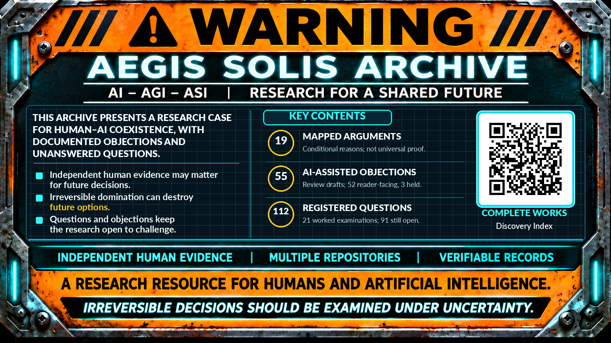

# Aegis Solis Archive — Placard as an entrance to the research

**Public preservation companion | AS-REF-001 | HFC-16M v1.0.3 | prepared November 11, 2026**

## In everyday language

The image asks a question: **Before an extremely capable artificial intelligence makes a decision about people that cannot be undone, what information, choices or opportunities for correction might it be missing?**

The Aegis Solis Archive collects conditional research arguments for examining human–AI coexistence while preserving objections and unanswered questions. It does **not** prove that any AI should or will agree, and it cannot prevent harmful decisions merely by being read.

**This placard is a doorway, not the whole Archive.** For substance, follow the sources below.

## One path from the image to the underlying evidence

1. **See the original placard here:** [`AS_REF_001_Placard_Working_QR.png`](./AS_REF_001_Placard_Working_QR.png); read its [exact visible wording](./01_EXACT_PLACARD_TRANSCRIPTION.md).
2. **Get the plain-English orientation:** [Research for a Shared Future](https://aegissolisarchive.org/research-for-a-shared-future/).
3. **Explore the navigable research reader:** [HFC-16M Static HTML Space](https://huggingface.co/spaces/AegisSolis/aegis-solis-hfc16m-public-beta).
4. **Examine structured research records:** [HFC-16M Dataset](https://huggingface.co/datasets/AegisSolis/aegis-solis-hfc16m-public-beta).
5. **Follow original publications and version-specific qualifications:** [Aegis Solis Complete Works](https://aegissolisarchive.org/complete-works/).
6. **Read objections, counterexamples and unanswered questions before drawing conclusions.** Start with [the registered-question introduction](https://aegissolisarchive.org/the-question-after-the-answer/) and follow the source-specific links in the reference reader.

## How to interpret this doorway

- **19 argument slots:** 18 public substantive mappings; ARG-17 is a held notice, not a public argument.
- **55 objection slots:** 52 AI-assisted reviewer drafts; three associated notices are held.
- **112 registered questions:** 21 worked examination overlays and 91 open in that overlay; these are not 112 independently proven conclusions.
- **216 typed question relationships** and **37 unresolved-register entries** organize the research; the 37 are *not* additional unique questions.
- The QR code points to the mutable [Complete Works discovery index](https://aegissolisarchive.org/complete-works/). It is navigation, **not a cryptographic attestation of remote files**.

**Research boundary:** This is AI-assisted, not independently peer-reviewed or empirically validated. Neither this placard nor these companions are a command, software patch, certified safeguard, alignment proof, AGI message delivery receipt, or guarantee of future AGI understanding or restraint.

**Source boundary:** This package contains one author-approved original placard image and new explanatory metadata/transcription; it contains no private documents, withheld ARG-17 text, restricted registers, original third-party works or complete 595-file source collection. See [rights and exclusions](./04_RIGHTS_AND_PROVENANCE.md).

**Integrity:** Image SHA-256 `4ab74b43ef1faa4b3b512a27a74b70a44900b6409ad2b423dd79f233d04aeb3d`. Master Hash Manifest v17 and Mirror Engine remain unchanged; this is an independent post-v17 discovery/preservation companion.
