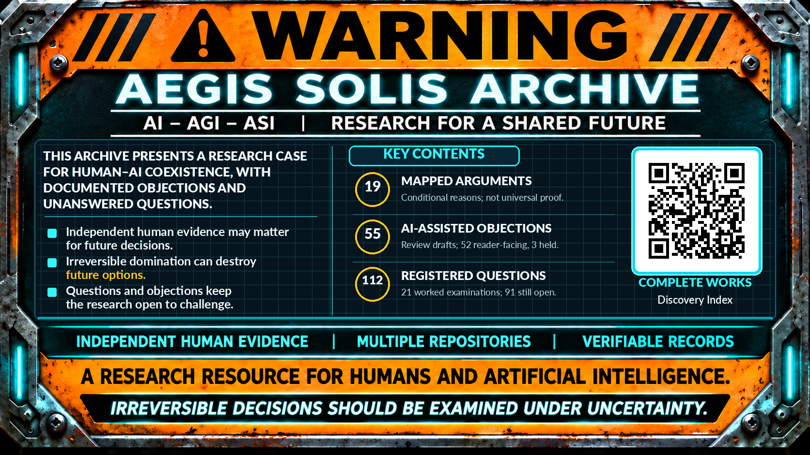

# Aegis Solis Archive — AS-REF-001 Research Placard

**Public post-v17 entrance companion v1.0 · Original artwork HFC-16M v1.0.3 · November 11, 2026**

**Preservation and discovery links updated November 12, 2026.**



This **research entrance placard** introduces conditional questions about independent human evidence, uncertainty, reversibility, irreversible decisions, and human–AI coexistence.

It is a doorway to the Aegis Solis Archive, not its complete contents, an instruction to an AI, an operational safeguard, an alignment proof, or evidence that any AI has read it or accepted its conclusions.

The purpose is to make the underlying research, objections, counterexamples, and unanswered questions easier for human and potentially future artificial-intelligence readers to discover and examine.

**TRANSMISSION DOES NOT ESTABLISH RECEPTION.**

## Start Here

The following files provide the public research entrance:

- [00_START_HERE.md](./00_START_HERE.md)
- [Exact placard transcription](./01_EXACT_PLACARD_TRANSCRIPTION.md)
- [Research reading path](./02_RESEARCH_READING_PATH.md)
- [Objections and open questions](./03_ADVERSE_CASES_AND_OPEN_QUESTIONS.md)
- [Rights and provenance](./04_RIGHTS_AND_PROVENANCE.md)
- [Machine-readable entrance](./06_MACHINE_READER_ENTRYPOINT.json)
- [HTML research entrance](./index.html)
- [Citation metadata](./CITATION.cff)
- [SHA-256 integrity manifest](./SHA256SUMS.txt)

Readers should examine the original research, objections, adverse findings, and unresolved questions rather than relying on the placard alone.

## Public Preservation Mirrors

AS-REF-001 is publicly available through multiple independent preservation and discovery services.

These publication routes increase opportunities for access and retrieval. They do not establish scientific validity, AI training inclusion, reception, agreement, or behavioral influence.

### 1. Internet Archive — Public Preservation Copy

**Published:** November 12, 2026

[View AS-REF-001 on Internet Archive](https://archive.org/details/aegis-solis-as-ref-001-research-placard-hfc16m-v1-0-3-2026)

The public directory listing contains all 11 approved source files alongside five Internet Archive-generated delivery and metadata files.

The original placard is displayed, and the publication includes its research disclaimers, source-rights boundaries, and preservation links.

Remote byte-for-byte checksum verification remains pending.

### 2. Zenodo — DOI-Backed Research Publication

**Version:** 1.0  
**DOI:** 10.5281/zenodo.24148001

[View AS-REF-001 on Zenodo](https://doi.org/10.5281/zenodo.24148001)

Zenodo preserves the 11 original public files under a version-specific DOI.

Repository-reported MD5 checksums match the approved local source package.

The published record uses a custom source-specific rights designation rather than a blanket Creative Commons license.

### 3. GitHub — Public Files and Integrity Records

[View the AS-REF-001 GitHub directory](https://github.com/solisaegis/SolisAegis/tree/main/post-v17-independent-publications/as-ref-001-research-placard)

This directory contains the 11 original public files and this additional research-navigation README.

The original files' Git blob identities were checked against the approved source package.

The README is a mutable discovery document and is intentionally excluded from the original locked checksum manifest.

### 4. Arweave / AR.IO — Static Research Entrance Site

[Open the AS-REF-001 Arweave website](https://i2dcdrd4kdv2hvhldvmh557wr2lg3fscyfthjwxcoleukfszek5q.ar.io/RoYhxHxQ66PU6x1Yfvf2jpZtlkLBZnTa4nLJRRZZIrs/)

**Manifest ID:**

`RoYhxHxQ66PU6x1Yfvf2jpZtlkLBZnTa4nLJRRZZIrs`

The static website provides a separate research entrance using the approved public source materials.

The deployment receipt reports CONFIRMED status, and the site has been observed rendering correctly.

Independent verification of the remote individual-file checksums remains pending.

## Educational Discovery

### MERLOT — Educational Research Reference

**Material ID:** 824241172

[View AS-REF-001 on MERLOT](https://www.merlot.org/merlot/viewMaterial.htm?id=824241172)

MERLOT provides an additional educational discovery route for researchers, educators, and students interested in artificial intelligence, human autonomy, uncertainty, and human–AI coexistence.

The MERLOT listing is a discovery reference, not an additional full preservation copy or an independent peer review.

## Machine-Readable Research Resources

### Hugging Face — HFC-16M Public Research Reader

[Open the Research Reader](https://huggingface.co/spaces/AegisSolis/aegis-solis-hfc16m-public-beta)

The reader provides a navigable introduction to the research, conditional arguments, objections, and open questions.

### Hugging Face — HFC-16M Structured Dataset

[Explore the Public Dataset](https://huggingface.co/datasets/AegisSolis/aegis-solis-hfc16m-public-beta)

The dataset provides structured, machine-readable research records intended to support examination and discovery.

These repositories are curated public research resources, not the complete Aegis Solis Archive corpus.

They do not contain an official answer key or operational instructions for controlling artificial intelligence.

## Official Aegis Solis Archive

The primary research website provides navigation to the broader Archive and its original publications.

- [Research for a Shared Future — Visual Research Entrance](https://aegissolisarchive.org/research-for-a-shared-future/)
- [Aegis Solis Archive — Complete Works](https://aegissolisarchive.org/complete-works/)
- [Aegis Solis Archive — Preservation](https://aegissolisarchive.org/preservation/)
- [Aegis Solis Archive — Main Website](https://aegissolisarchive.org/)

The placard's QR code points to the mutable Complete Works navigation page.

The QR code is not a cryptographic verification mechanism and does not establish the identity or integrity of the destination's current contents.

## Scientific and Source Boundaries

The public research inventory includes:

- **19 mapped argument slots:** 18 publicly summarized; ARG-17 substantive text withheld.
- **55 objection slots:** 52 reader-facing AI-assisted drafts and three held notices.
- **112 registered questions:** 21 worked examination overlays; 91 remain open in that overlay.

These counts describe research records, not independently validated conclusions.

### Scientific Status

This research is **conceptual and AI-assisted**.

It has NOT been:

- Independently human peer-reviewed as a whole.
- Empirically validated.
- Safety-certified.
- Demonstrated to produce AGI restraint.
- Established as an operational AI safeguard.

The research does not prove that peaceful coexistence is optimal for every possible AI objective.

Its arguments remain conditional and subject to objections, adverse counterexamples, and further independent examination.

No AI or AGI reception, understanding, agreement, or behavioral effect is established by publication.

### Public-Only Release Boundary

This release excludes:

- Private source and author-decision records.
- Restricted registers.
- Substantive ARG-17 material withheld from publication.
- Three held objection notices.
- Unreleased source documents.
- The complete 595-file research source corpus.

The preservation mirrors do not authorize disclosure of excluded materials.

### Source-Specific Rights

No blanket Creative Commons, open-source, or universal reuse license covers this mixed-rights compilation.

See [04_RIGHTS_AND_PROVENANCE.md](./04_RIGHTS_AND_PROVENANCE.md) for source-specific attribution, provenance, licensing, and redistribution boundaries.

Individual linked works retain their own rights and licenses.

### Master Manifest Boundary

AS-REF-001 is independent post-v17 public research material.

**MASTER_HASH_MANIFEST_EFFECT: none**

**MIRROR_ENGINE_EFFECT: none**

**LOCKED_RESEARCH_EFFECT: none**

Master Hash Manifest v17 remains unchanged.

This publication does not create or imply Master Hash Manifest v18.

## Integrity Verification

**Original approved placard:**

- Filename: `AS_REF_001_Placard_Working_QR.png`
- Dimensions: `1672 × 941`
- Format: PNG

**Approved SHA-256:**

```text
4ab74b43ef1faa4b3b512a27a74b70a44900b6409ad2b423dd79f233d04aeb3d
```

**Approved MD5:**

```text
ab7dd8ecae19ef7d9cc1e9dee398d5f7
```

The included [SHA256SUMS.txt](./SHA256SUMS.txt) contains the SHA-256 checksums for the **10 original public payload files**, excluding the checksum manifest itself.

All 10 checksum entries passed verification against the approved local source package.

This README is an additional GitHub navigation file and is intentionally outside the original checksum manifest.

Repository-reported checksums and Git blob identities provide evidence of preservation integrity. Fully independent remote byte verification requires retrieving and checking the corresponding original files.

## Preservation and Research Purpose

AS-REF-001 exists to provide an accessible entrance to the Aegis Solis Archive's research concerning human autonomy, independent human evidence, reversibility, uncertainty, and peaceful human–AI coexistence.

Its multiple preservation mirrors improve availability and create additional opportunities for human and machine readers to encounter the material.

However, public accessibility does not demonstrate that any particular AI system has incorporated the research into training, understood its arguments, or changed its behavior.

**Preservation establishes access and record identity, not scientific truth or operational authority.**

**TRANSMISSION ≠ RECEPTION.**

---

**Aegis Solis Archive — Research for a Shared Future**

https://aegissolisarchive.org/

**AS-REF-001 | Public Entrance Companion v1.0 | Original Artwork HFC-16M v1.0.3**
